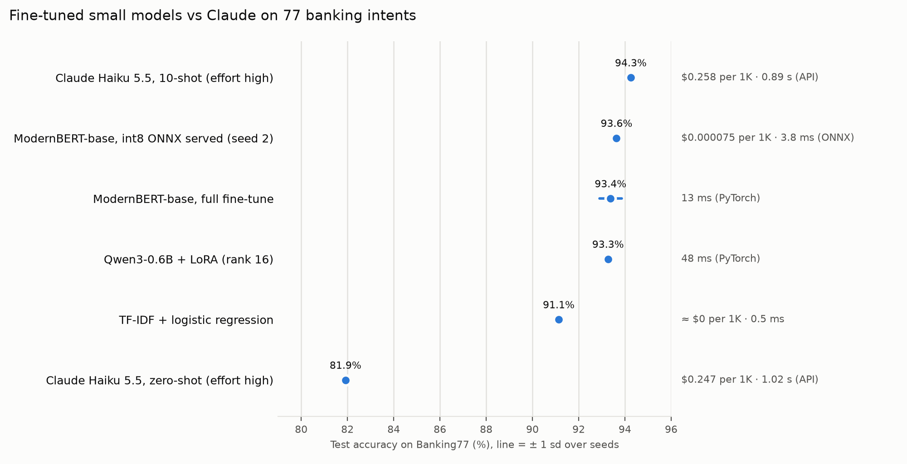

# TuneBench

**Does a fine-tuned small model beat Claude on a narrow task?** Four approaches
to the same job, classifying a bank customer's message into one of 77 intents
(Banking77), all scored on the same held-out test set of 3,080 messages.



| Approach | Test accuracy | Macro-F1 | p50 latency, 1 message | $ per 1K requests |
|---|---|---|---|---|
| TF-IDF + logistic regression | 91.1% | 0.911 | 0.5 ms | ≈ $0 |
| ModernBERT-base, full fine-tune (3 seeds) | 93.4 ± 0.5% | 0.934 ± 0.005 | 13 ms (PyTorch, CPU) | — |
| ↳ the best seed served as int8 ONNX | 93.6% | 0.936 | 3.8 ms (CPU) | $0.000075 (self-hosted) |
| Qwen3-0.6B + LoRA, classification head (3 seeds) | 93.3 ± 0.1% | 0.933 ± 0.001 | 48 ms (PyTorch, CPU) | — |
| Claude Haiku 5.5, zero-shot | 81.9% | 0.813 | 1.02 s (API) | $0.247 |
| Claude Haiku 5.5, 10 retrieved examples | 94.3% | 0.943 | 0.89 s (API) | $0.258 |

Everything is in [RESULTS.md](RESULTS.md), rebuilt from the per-run files in
`results/` by `scripts/report.py`: every training run, the LoRA rank sweep,
paired significance tests, the export, latency and the error analysis.

## What I found

- **A 150M-parameter model fine-tuned in 10 minutes is statistically
  indistinguishable from Claude with retrieved examples.** Claude is about a
  point ahead, but on the same 3,080 messages a paired McNemar test gives
  p = 0.11. Served as int8 on a CPU, the small model answers in about 4 ms
  for under $0.0001 per 1,000 requests: over 3,000x cheaper and about 200x
  faster than the API call. The LoRA-tuned Qwen3-0.6B (4x the parameters)
  lands in the same place (93.3%, p = 0.61 against ModernBERT).
- **Claude without examples is the weakest approach, below a TF-IDF
  baseline.** The 77 intent names alone don't say where Banking77 draws its
  lines (`card_arrival` vs `card_delivery_estimate`, `top_up_failed` vs
  `top_up_reverted`). Ten labeled neighbors from the training set, picked by
  TF-IDF similarity, add 12 points, for 4% more cost: the prompt grows by
  about 350 tokens, and Claude thinks less (47 output tokens instead of 94).
- **The baseline is strong.** TF-IDF with character n-grams reaches 91.1%;
  fine-tuning buys about two points on this dataset, and the paired test says
  those two points are real (p < 1e-7).
- **int8 makes serving 1.8x faster for 0.1 points of accuracy.** The file
  shrinks from 599 MB to 151 MB, and two CPU cores handle 1.6x the requests
  (269 against 173 per second over HTTP).
- **Many remaining errors are the dataset's.** See below.

## Error analysis

The fine-tuned model and Claude both miss the same 111 test messages, and 80
of those get *the same wrong answer* from both. Reading a sample of them:

| Message | Gold label | Both models said |
|---|---|---|
| When I try and to buy something using my card it keeps getting declined. | `declined_transfer` | `declined_card_payment` |
| Where can I view my PIN? | `pin_blocked` | `get_physical_card` |
| How can I top-up my card? | `top_up_by_cash_or_cheque` | `topping_up_by_card` |
| my card was not in the mail again can you advise? | `card_delivery_estimate` | `card_arrival` |
| How long until my transfer will be available to me | `balance_not_updated_after_bank_transfer` | `transfer_timing` |
| Will a transfer incur a fee? | `top_up_by_bank_transfer_charge` | `transfer_fee_charged` |

In 4 of the 14 I read, the gold label looks wrong (the first three rows
above); most of the rest sit between two intents that overlap, where either
answer is defensible. The most-confused pairs for each model are in
RESULTS.md: both struggle with the same families (transfers that haven't
arrived, top-ups that failed or were reverted, card delivery). So the last
few points on Banking77 measure agreement with its annotators as much as
understanding, and a model that scores 94% is close to what the labels allow.

## How it works

```
PolyAI/banking77 (pinned parquet, sha256-checked)
  ├─ train 10,003 ──► stratified 10% ─► validation 1,001 (rows committed in splits/)
  │                └─► train 9,002
  └─ test 3,080 (used once per model, after training)

train ─► TF-IDF + LR            ─┐
train ─► ModernBERT-base (full)  ├─► results/<run>.json  ─► scripts/report.py ─► RESULTS.md, docs/accuracy.png
train ─► Qwen3-0.6B + LoRA      ─┤    scores + test predictions
train ─► Claude few-shot pool   ─┘

best ModernBERT seed (by validation) ─► ONNX float32 ─► int8 ─► FastAPI + ONNX Runtime ─► Docker
```

| Path | What it does |
|---|---|
| `src/tunebench/data.py` | Downloads and checks the data, carves validation from train |
| `src/tunebench/baseline.py` | TF-IDF + logistic regression, C chosen on validation |
| `src/tunebench/claude.py` | Claude zero-/few-shot with a structured-output enum and a hard spend cap |
| `src/tunebench/train.py` | Fine-tuning for both ModernBERT and Qwen3 LoRA (Hugging Face Trainer, MLflow) |
| `src/tunebench/export.py` | ONNX export, int8 quantization, accuracy of both files |
| `src/tunebench/serve.py` | The FastAPI server (ONNX Runtime, no PyTorch) and its demo page |
| `src/tunebench/metrics.py` | Accuracy, macro-F1, confusion pairs, McNemar |
| `scripts/` | Split, latency benchmarks, report, test fixture, publishing to Hugging Face |
| `notebooks/train.ipynb` | Thin wrapper to train on a free Kaggle or Colab GPU |

## Design decisions

- **Validation is carved from train; test is touched once per model.** C,
  the LoRA rank, the int8 scheme and the served seed are chosen on
  validation. Learning rates are standard values for each model, not tuned.
  Fine-tuned results are mean ± standard deviation over 3 seeds.
- **Qwen3-0.6B rather than the newer Qwen3.5-0.8B.** Qwen3.5 is a
  vision-language model built mostly from linear-attention (Gated DeltaNet)
  layers whose fast kernels need CUDA; on an Apple GPU it would fall back to
  slow reference code. Qwen3 is a plain transformer.
- **A classification head on the LLM, not generated label text.** One forward
  pass, always one of the 77 intents, scored exactly like the encoder. LoRA
  adapters go on every linear layer; the head is trained fully.
- **Claude answers through a structured output** whose only field is an enum
  of the 77 names, so it can't invent a label. Each run has a hard dollar cap
  checked before every request (counting requests in flight), and answers are
  logged as they arrive so a stopped run resumes without paying twice.
- **Few-shot examples are retrieved, not fixed.** The 10 training messages most
  similar to the query (TF-IDF cosine) are shown with their labels. That costs
  little (about 350 extra input tokens) and teaches the dataset's conventions
  where they matter.
- **The serving image has no PyTorch.** The server needs ONNX Runtime,
  `tokenizers`, numpy and FastAPI; the export test checks that ONNX logits match
  PyTorch's to 1e-4 and that the standalone tokenizer gives the same ids.
- **Dynamic int8 quantization** (weights in 8 bits, activations quantized at
  run time) needs no calibration data. Per-channel scales kept 0.2 points
  more validation accuracy than one scale per matrix on the served model, so
  the export uses them (`scripts/quant_variants.py`).
- **Every run's test predictions are committed**, so every number in
  RESULTS.md, including the significance tests, can be recomputed from the
  repo without running a model.

## Reproduce

Needs [uv](https://docs.astral.sh/uv/). Training used an Apple M5 Pro GPU; any
CUDA GPU works, and `notebooks/train.ipynb` runs on Kaggle's or Colab's free T4.

```bash
uv sync
uv run python scripts/make_split.py          # optional: the committed split, rebuilt
uv run python -m tunebench.baseline
uv run python -m tunebench.train --model modernbert --seed 0      # also seeds 1, 2
uv run python -m tunebench.train --model qwen3-lora --seed 0 --rank 16     # results/qwen3-lora-r16-seed0.json
uv run --env-file .env python -m tunebench.claude --shots 10 --max-usd 1.5   # needs ANTHROPIC_API_KEY
uv run python -m tunebench.export artifacts/modernbert-seed2
uv run python scripts/quant_variants.py artifacts/onnx/modernbert-seed2
uv run python scripts/latency.py artifacts/onnx/modernbert-seed2
uv run python scripts/report.py
uv run pytest
```

MLflow keeps every training run (`uv run mlflow ui --backend-store-uri sqlite:///mlflow.db`).

## Serve it

```bash
docker build -t tunebench .
docker run -p 8000:8000 -v "$PWD/artifacts/onnx/modernbert-seed2:/model:ro" tunebench
curl -s localhost:8000/predict -H 'content-type: application/json' \
  -d '{"text": "I still have not received my new card"}'
```

`GET /` is a small page to try it; `GET /health` reports the model file.

## Limits

- One dataset and one language. Banking77 is short, single-turn English
  messages; the model has no "none of these" class.
- Latency was measured on an idle Apple M5 Pro CPU. The cost per 1K
  self-hosted requests assumes a 2-vCPU AWS c7g.large ($0.0725/hour) running
  at the 2-core throughput measured here; a cloud vCPU is slower, so read it
  as an order of magnitude.
- Claude results are one run each (the API is not seeded). Their cost is the
  token usage the API reported, at list prices.
- On the Qwen LoRA runs the new classification head trains in bfloat16
  without a float32 copy, so its last, smallest updates round away. Keeping a
  float32 copy is the next thing to try there; the code does it already on
  float16 GPUs, where training can't run without it.

Data: Banking77 (Casanueva et al., 2020), CC BY 4.0. Base models:
ModernBERT-base (Apache 2.0), Qwen3-0.6B (Apache 2.0).
